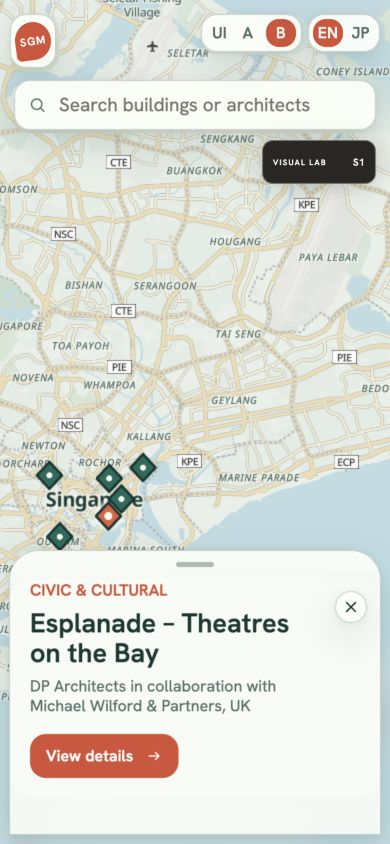
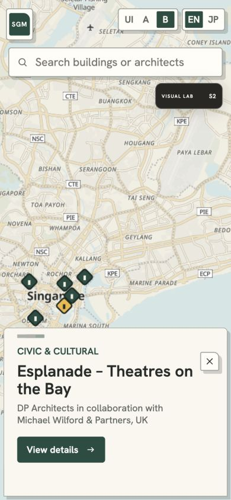
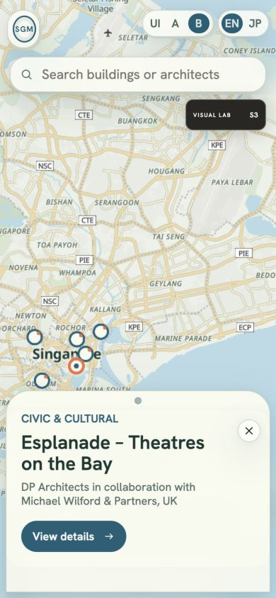

# SGM Visual Language Lab 01

`SGM_Visual_System_Codex_Handoff_v0.1`と`SGM_Project_Brief_v0.3`を基準に、既存のVisual A/B/Cの延長に限定せず、ピン、地図、UI面、形状、動きの関係を比較する可逆な実験です。勝者を決めるものではありません。

## 監査

- 現行はVisual A/B/Cで色、角丸、影、余白を変更できる一方、ピンは全案でcircle layer、通常アイコンは同一SVG、選択フィードバックは色と大きさの変更が中心でした。
- MapLibreの同一map instanceとGeoJSON sourceを維持すれば、地図位置・ズーム・選択建築・Bottom Sheet状態を失わずに比較できます。
- OpenFreeMap Libertyの既存layer IDへpaint propertyを適用する方式は実験用です。外部styleの将来変更に対する安定APIではありません。
- B Bottom Sheet、7件のデータ、検索、現在地、外部リンク、地図クレジット、EN/JAは共通です。

## 比較案

| Code | Name | 記号 | 地図と色 | Surface / geometry | Feedback hypothesis |
|---|---|---|---|---|---|
| BL | Current baseline | 現行circle pin | Civic C + M1 | 現行値を変更しない | 既存の比較基準 |
| S1 | Signal Field | 中心を抜いた方向性のある菱形 | 冷たい緑・水色の地理に、選択時coral | 半透明の柔らかな面、丸い角、低い多層影 | 少し長いease-outと軽いpress縮小で連続探索を促す |
| S2 | Civic Tiles | 建築タイル／入口を思わせる菱形 | 温かな紙色に深緑、選択時yellow | 不透明、細い濃色outline、非対称角、offset shadow | 短く直接的な移動とpress offsetで明快さを優先 |
| S3 | Island Orbit | ringとoffset dot | 水・緑をやや明確にし、blue ringとcoral | 半透明、pill/ring、広い角、柔らかな影 | ゆっくり過ぎないspring-like easeとscale feedback |

通常操作のsearch / locate / close / external-linkは意味の確立した線アイコンを維持し、各案ではstroke、container形状、面との関係だけを変えました。独自記号は建築ピンとhandle/brand-markの関係に限定しています。

| S1 Signal Field | S2 Civic Tiles | S3 Island Orbit |
|---|---|---|
|  |  |  |

## 切替

- `?ui=b&lab=baseline`
- `?ui=b&lab=signal`
- `?ui=b&lab=tile`
- `?ui=b&lab=orbit`

英語版の折りたたみ式`VISUAL LAB`からBL / S1 / S2 / S3を選べます。S1–S3は比較条件を揃えるため、Hanken Grotesk、SGM light mobile scale、B Bottom Sheetを適用します。JAでもURLパラメータを引き継ぎますが、実験UIは表示しません。

Visual Languageの切替はmapを再生成しないため、center / zoom / selected building / expanded sheetを維持します。言語切替では選択IDとsheet状態をURLにも保持し、地図カメラは既存のsessionStorageで引き継ぎます。

## 観察済み

- 390 × 844のブラウザviewportでS1/S2/S3の地図・記号・surface差を確認。
- 検索からEsplanadeを選択し、compact / expandedの両状態を確認。
- expandedのままS2からS3へ切り替え、選択建築とsheet状態が維持されることを確認。
- EN/JAの直接URLで選択建築とexpanded状態が復元されることを確認。
- `prefers-reduced-motion`では既存ルールによりanimation / transitionを最短化。
- typecheck / build / publication data checkを通過。

## 未検証・判断材料

- 実機Safariでの`backdrop-filter`の描画負荷と可読性。
- 密集データが増えた場合の菱形／ring markerの衝突とcluster表現。
- S1のcoral、S2のyellow、S3のblue/coralについて、地図上とUI上の非テキストcontrast測定。
- 3件を連続選択した際、S1の柔らかさ、S2の直接性、S3の遊びが実際の探索速度と再訪意向にどう影響するか。
- S2の非対称角が「建築的」に見えるか、単に硬く見えるか。
- S3のring/dotが現在地記号と混同されないか。
- MapLibre styleのlayer名変更に備えたtheme適用の保守方法。

次のレビューでは、`印象（SGMらしさ・親しみ）`と`行動（3件選択、検索、戻る、外部リンク）`を別々に記録し、案全体ではなく「残したい関係」を選びます。
